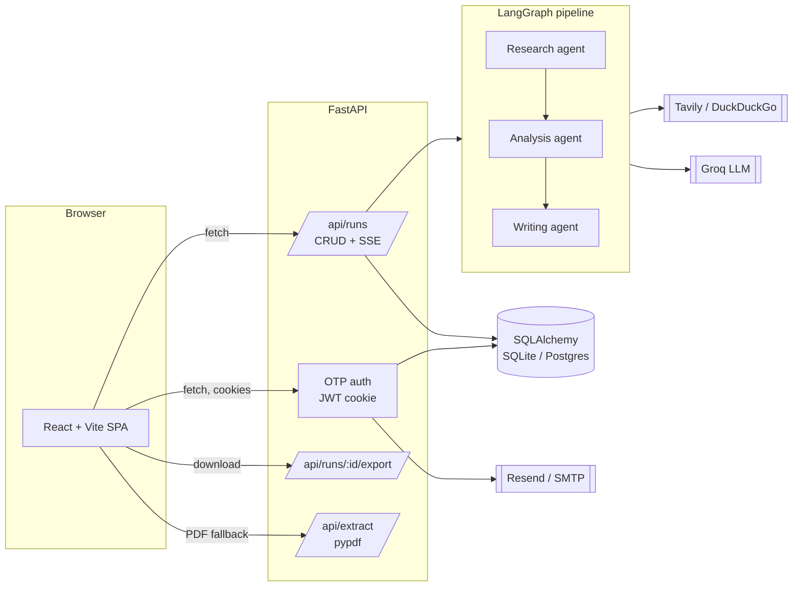

# CiteBolt — research, distilled

CiteBolt turns a topic into a source-cited research report. A three-agent LangGraph pipeline
(Research → Analysis → Writing) searches the web, extracts structured insights, and writes a
Markdown report you can read, export and come back to.

- **Frontend:** React 19 + Vite + Tailwind CSS v4 + React Router (light & dark themes)
- **Backend:** FastAPI + LangGraph, SQLAlchemy (SQLite by default, Postgres via `DATABASE_URL`)
- **Auth:** email one-time codes → httpOnly JWT cookie
- **Exports:** Markdown, PDF (ReportLab), Word (python-docx)

## Architecture



## Layout

```
backend/
  app/
    main.py        FastAPI routes (auth, runs, export, settings, contact)
    models.py      SQLAlchemy models: users, otp_codes, runs, user_settings, contact_messages
    db.py          Engine + session factory (SQLite default, Postgres via DATABASE_URL)
    security.py    JWT sessions, OTP hashing, auth dependencies
    emailer.py     Resend → SMTP → console fallback
    runtime.py     In-memory run registry + SSE event log
    graph.py       LangGraph pipeline
    agents/        research.py, analysis.py, writer.py
    export.py      Markdown → PDF / DOCX
  Dockerfile
src/
  pages/           Landing, Login, Workspace, NewRun, RunProgress, Runs, Settings, Contact, Legal
  components/      Sidebar, AppShell, RunComposer, RunCard, StatusBadge, ThemeToggle, ErrorBoundary
  hooks/           useAuth, useRuns
  lib/             api, theme, pdf
```

## Setup

### 1. Backend

```bash
cd backend
python3 -m venv .venv && source .venv/bin/activate
pip install -r requirements.txt
cp env.example .env        # fill in GROQ_API_KEY (and optionally TAVILY_API_KEY)
uvicorn app.main:app --reload --port 8000
```

The database is created automatically at `backend/data/reports.db` (ignored by git).
With no `RESEND_API_KEY` or `SMTP_HOST` configured, sign-in codes are printed to the backend
console, so local development needs no email provider.

### 2. Frontend

```bash
bun install                # or npm install
bun run dev                # http://localhost:5173
```

By default the Vite dev server proxies `/api` to `http://127.0.0.1:8000`. To point the frontend
at a different backend, set `VITE_API_URL` in your environment (for example in a local `.env.local`) and restart the dev server.

### 3. Sign in

Open `/login`, enter an email, then use the 6-digit code from your inbox — or from the backend
console when no email provider is configured.

## Deploy

**Database (Neon Postgres).** Create a database and copy the connection string. Set
`DATABASE_URL=postgresql://…` on the backend; tables are created on startup.

**Backend (Render).** Deploy `backend/` using the included `Dockerfile` (or
`uvicorn app.main:app --host 0.0.0.0 --port $PORT`), and set:

| Variable | Purpose |
| --- | --- |
| `GROQ_API_KEY`, `GROQ_MODEL` | LLM |
| `TAVILY_API_KEY` | Optional higher-quality search |
| `DATABASE_URL` | Postgres connection string |
| `JWT_SECRET` | Session signing key (required in production) |
| `FRONTEND_URL` | Public frontend URL (enables secure cookies on HTTPS) |
| `ALLOWED_ORIGINS` | Comma-separated CORS origins |
| `RESEND_API_KEY`, `FROM_EMAIL` | OTP email delivery |
| `CONTACT_EMAIL`, `SUPPORT_EMAIL` | Contact form target |
| `DAILY_RUN_LIMIT` | Runs per user per day (default 10) |

**Frontend (Vercel).** Import the repo, build with `npm run build`, output `dist`, and set
`VITE_API_URL` to the Render backend URL.

## Features

- Email OTP sign-in with resend timer, 10-minute codes, 3 requests / 10 minutes, 5 attempts.
- Per-user history: every run belongs to a user; endpoints only return their runs.
- Live progress at `/runs/:id` over SSE with cancel and retry.
- Report types (Auto, Briefing, Deep dive, Architecture blueprint) shape the writer prompt.
- PDF/TXT/MD uploads: pdf.js in the browser, `pypdf` on the server as a fallback.
- Exports: Markdown, PDF and Word with a title, sections and a sources list.
- Light, dark and system themes applied before first paint.
- Settings (defaults stored per user), contact form, delete-all-runs.
- Daily run limit, input validation, retry/backoff around LLM and search calls.

## Screenshots

Add screenshots here after a run (dark and light):

| Page | Dark | Light |
| --- | --- | --- |
| Landing | `docs/landing-dark.png` | `docs/landing-light.png` |
| Workspace | `docs/workspace-dark.png` | `docs/workspace-light.png` |
| New run | `docs/new-run-dark.png` | `docs/new-run-light.png` |
| Run progress | `docs/progress-dark.png` | `docs/progress-light.png` |
| Report | `docs/report-dark.png` | `docs/report-light.png` |
| Settings | `docs/settings-dark.png` | `docs/settings-light.png` |

## Tests

```bash
cd backend && python3 -m pytest        # if you add tests
bun run build                          # frontend typecheck + production build
```
